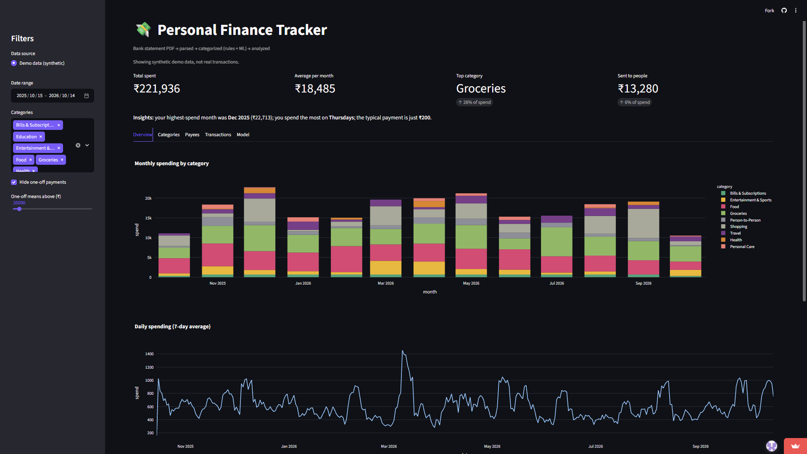
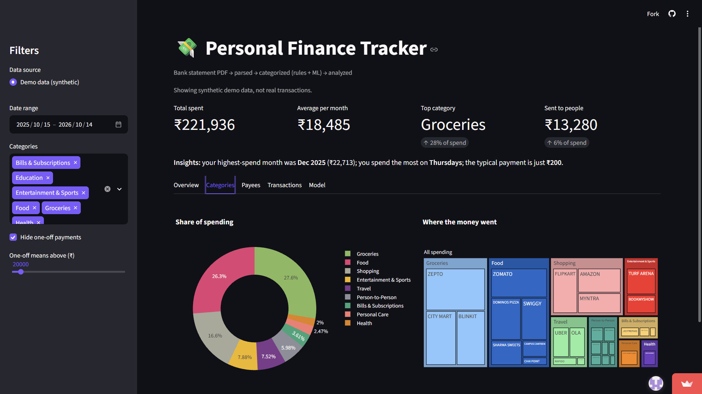

# Personal Finance Tracker

Turns a bank statement PDF into a categorized, analyzed spending dashboard.
Built on my own 12 months of real statements (1,251 transactions). The live demo uses synthetic data, so no real transactions are public.

**Live demo:** https://finance-tracker-g9f6iflz3rtf5mqos4xuyv.streamlit.app/
(Free hosting: if the app has been idle, it may take about 30 seconds to wake up.)




## How it works

PDF statement -> parse -> validate -> categorize -> analyze -> dashboard

1. **Parse.** The statement is text-aligned, not a table, and each transaction is split across two or three lines. I wrote a regex parser that groups lines into blocks and extracts date, payee, amount and balance.
2. **Validate.** The statement prints a running balance after every transaction, so each row must satisfy `balance = previous balance + amount`. This check caught the parser's early bugs (it missed rows with different reference-number formats) and now passes with 0 mismatches over 1,251 rows.
3. **Categorize.** In priority order: my manual payee labels, then own-name detection (transfers between my own accounts), then keyword rules, then a rule that a payee who has ever sent me money is a person.
4. **Analyze.** Monthly and category summaries, top payees, and handling of one-off payments such as the college fee.
5. **Dashboard.** Streamlit and Plotly, with filters, a payee view, a searchable transactions table, and a model evaluation tab.

## Key decisions

- **Label by payee, not by transaction.** The statement has 334 unique payees, and most spending goes to individuals and small shops. I labeled the most frequent payees by hand and verified each label against payment-app history and my Splitwise records, instead of guessing.
- **Evaluate ML honestly.** Random train/test splits put the same payee in both sets, so the model just remembers names. I split by payee instead, which tests it on payees it has never seen.
- **Prefer the simpler system when it wins.** The results below show where ML helped and where rules did better.
- **Keep private data private.** Real statements and labels stay in a gitignored folder. The public demo runs on synthetic data from `scripts/generate_fake_data.py`.

## Results

Measured on my real data: 689 labeled spending payments from 107 payees, tested on unseen payees.

| Task | Guess the common class | Rules | ML model |
|---|---|---|---|
| Person vs merchant (2 classes) | 72.7% | 97.2% (payee ever sent me money) | 98.1% |
| Spending category (6 classes) | 28.6% | 36.0% (keywords) | 49.1% |

- **People vs shops is easy.** One rule captures it, and ML adds under a point.
- **Food vs groceries vs bills is hard.** ML beats the keyword rules overall, but only because it separates people from shops well. Among shop payments alone, the keyword rules do better.
- With a random split, the six-class model scores 93.3% against 49.1% on unseen payees, which is why the split matters.

## Limitations

- Only bank transactions are analyzed. Cash spending is not captured.
- Small dataset: 107 labeled payees, one person, one bank's statement layout. The parser is written for that layout.
- Category labels are my own judgment. The keyword rules were written after seeing my payees, so their score is optimistic.
- The demo data is synthetic and doesn't reproduce my real spending patterns.

## Tech stack

Python, pandas, pdfplumber, regex, scikit-learn, Plotly, Streamlit.

## Run locally

```
pip install -r requirements.txt
python scripts/generate_fake_data.py
streamlit run app.py
```

To use your own statement: put the PDF at `data/private/statement.pdf`, create a `.env` file with `OWN_NAME=YOUR NAME AS ON THE STATEMENT`, then run `python run_pipeline.py`. The parser expects the layout of the bank this was built for, so other banks need parser changes.

## Project structure

```
app.py                    Streamlit dashboard
run_pipeline.py           PDF -> parsed -> categorized CSV
src/parser.py             PDF text -> transactions, balance check
src/categorizer.py        labels, keywords, own-name and received-money rules
src/analytics.py          monthly summaries and other analysis
src/ml_model.py           person-vs-merchant and category models, evaluation
scripts/generate_fake_data.py   synthetic demo data
```

## Future work

Import Splitwise exports to detect people automatically, support more bank formats, try name embeddings for categories, and add tests.